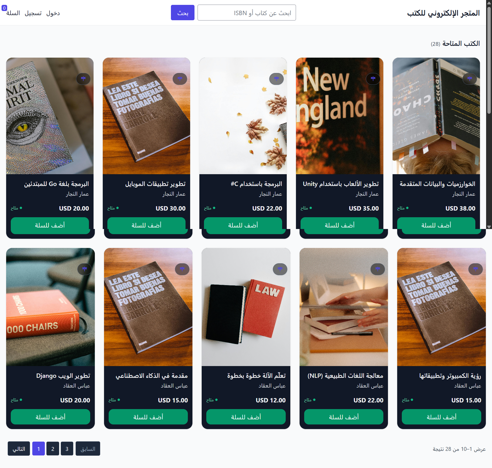
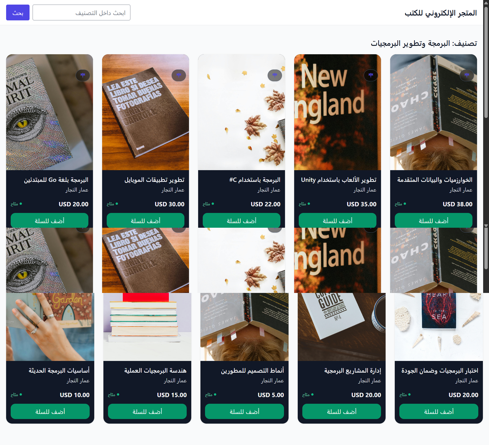
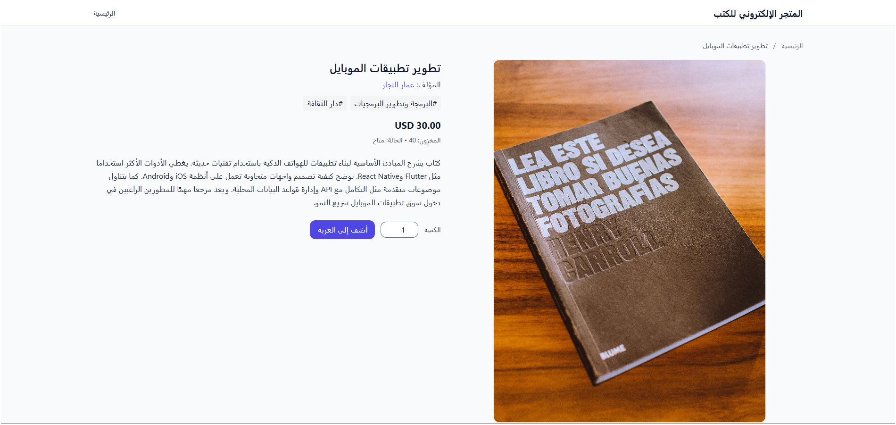
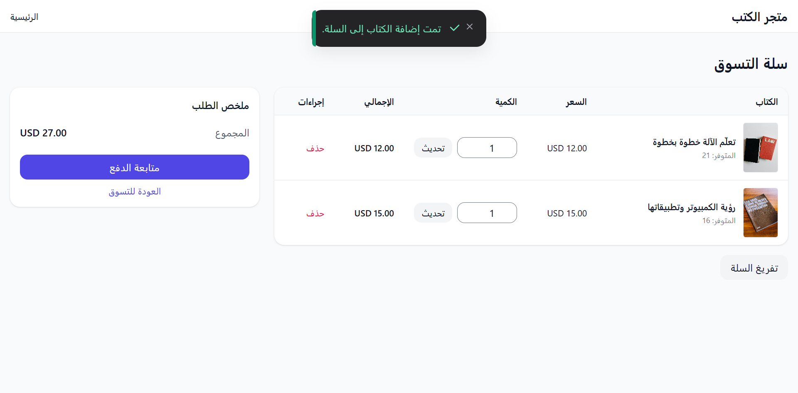
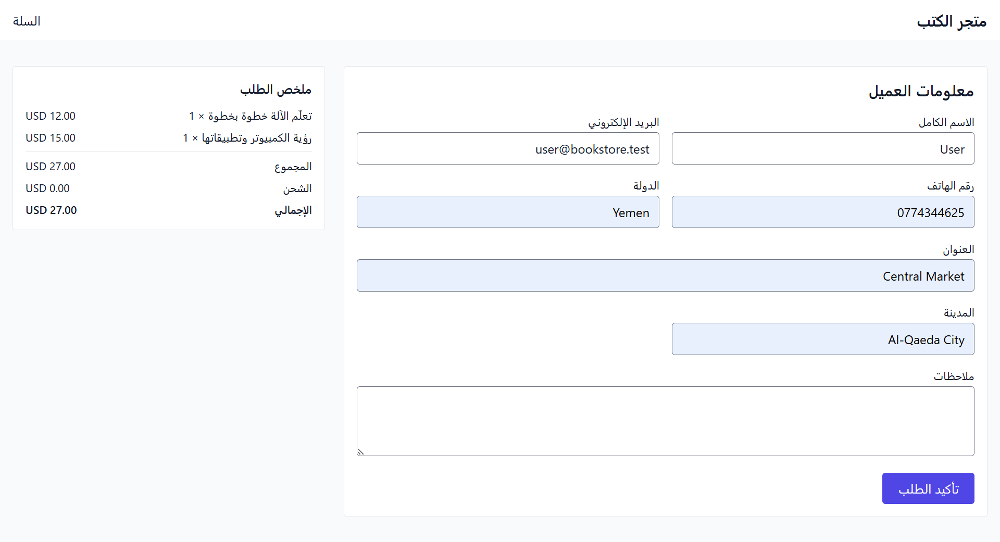
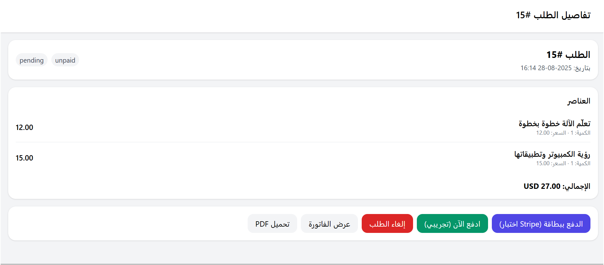
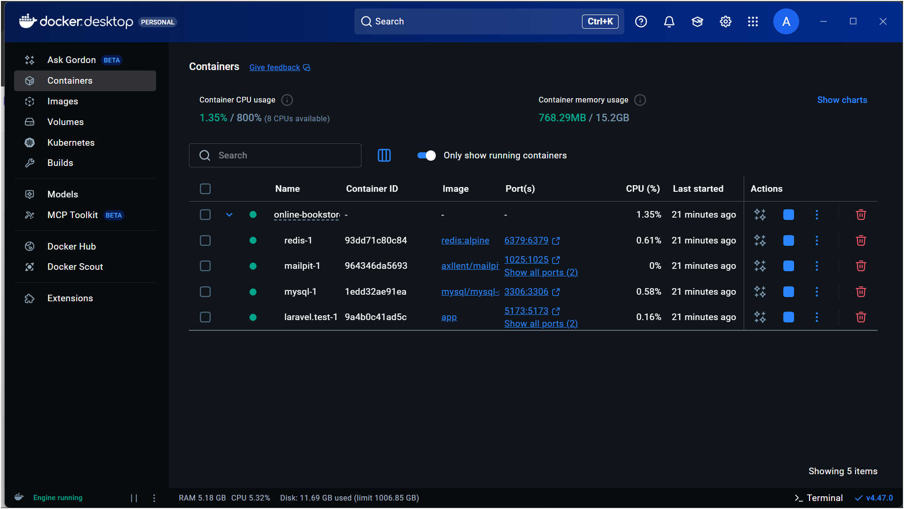
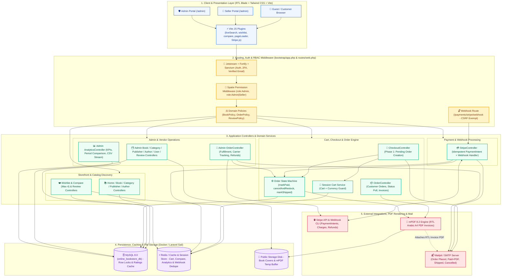
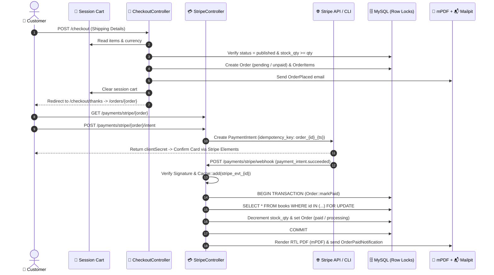
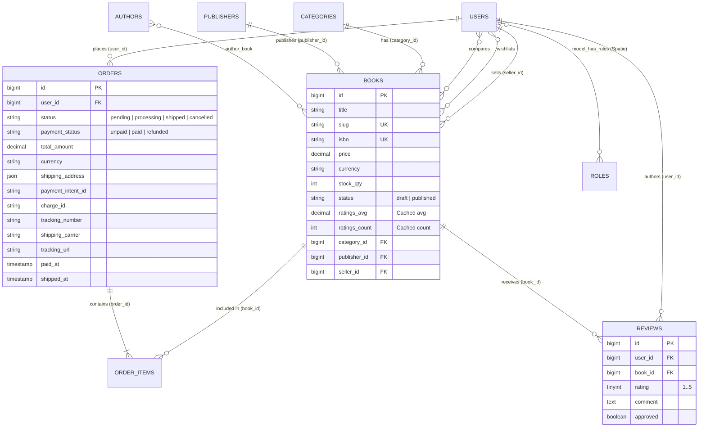

# Online Bookstore System

A modern, RTL-ready (Arabic) multi-vendor online bookstore built with **Laravel 12**, featuring a rich product catalog with live AJAX search & multi-faceted filtering, wishlist & book comparison, session cart & two-phase checkout, **Stripe** payments (test mode) with webhook handling, RTL invoice PDFs (**mPDF**), email notifications via **Mailpit**, a role-based admin & seller portal (**Admin / Seller / User**) with sales analytics & CSV export, and a clean Tailwind CSS UI.


-EC1C24?style=flat-square&logo=adobeacrobatreader&logoColor=white)


---

## Table of Contents

- [Screenshots](#screenshots)
- [Features](#features)
- [Tech Stack](#tech-stack)
- [System Architecture](#system-architecture)
- [Requirements](#requirements)
- [Quick Start (TL;DR)](#quick-start-tldr)
- [Option A (Recommended): Docker via Laravel Sail](#option-a-recommended-docker-via-laravel-sail)
  - [Step 1 — Clone & configure](#step-1--clone--configure)
  - [Step 2 — Boot services](#step-2--boot-services)
  - [Step 3 — App key, storage, migrations & seeders](#step-3--app-key-storage-migrations--seeders)
  - [Step 4 — Frontend assets](#step-4--frontend-assets)
  - [Step 5 — Stripe (test mode) & webhook](#step-5--stripe-test-mode--webhook)
  - [Useful Sail commands](#useful-sail-commands)
  - [Windows + WSL2 tips](#windows--wsl2-tips)
- [Option B: Native (No Docker)](#option-b-native-no-docker)
- [Environment Variables](#environment-variables)
- [Mailpit (Local Email)](#mailpit-local-email)
- [Users, Roles & Demo Credentials](#users-roles--demo-credentials)
- [Queues (Optional but Recommended)](#queues-optional-but-recommended)
- [Common Tasks](#common-tasks)
- [Troubleshooting](#troubleshooting)
- [Production Notes](#production-notes)
- [Project Structure](#project-structure)
- [Contributing](#contributing)
- [Security](#security)
- [Author](#author)
- [License](#license)

---

<a id="screenshots"></a>
## لقطات الشاشة | Screenshots

🏠 الصفحة الرئيسية | Home

صفحة الهبوط تعرض الكتب المميّزة والأقسام وروابط التصفّح والبحث السريع.


🗂️ صفحة التصنيف | Category

تصفّح كتب تصنيف معيّن مع خيارات الفرز والترقيم.


🏢 صفحة الناشر | Publisher

عرض بيانات الناشر وكامل كتبه المنشورة في المتجر.


✍️ صفحة المؤلف | Author

نبذة المؤلف وقائمة أعماله مع روابط تفصيل الكتب.


📘 تفاصيل الكتاب + المراجعات | Book Details + Reviews

صفحة المنتج: الصور والوصف والسعر والتوفّر والإضافة للسلة والمفضّلة والمقارنة مع استعراض/كتابة المراجعات.


🛒 سلة التسوّق | Cart

مراجعة العناصر وتحديث الكميات/الحذف والانتقال لإتمام الطلب.


💳 صفحة إتمام الطلب | Checkout

إدخال عناوين الشحن/الفوترة مع ملخص نهائي قبل الدفع.


🔍 تفاصيل الطلب (عميل) | Order Details (Customer)

تفاصيل العناصر والمبالغ والإجراءات (دفع/إلغاء/عرض وتنزيل الفاتورة).


🐳 حاويات Docker (Laravel Sail) | Docker Containers

تشغيل خدمات المشروع (Laravel App, MySQL 8, Redis, Mailpit) عبر Docker.


---

## Features

- 📚 **Catalog, Live Search & Filtering**: Books with categories, publishers, multiple authors (`author_book`), cover images, stock, and pricing. Includes instant **AJAX live search** (`/books/search`) and multi-faceted filtering (price range, category, publisher, authors, and sorting by newest, price, or rating).
- ❤️ **Wishlist (`/wishlist`)**: Authenticated users can save favorite books with instant AJAX toggling and cache-backed counters.
- ⚖️ **Book Comparison (`/compare`)**: Side-by-side comparison for up to **4 books** at once, supporting both **guests** (via Session) and **logged-in users** (via Database + Cache).
- 🛒 **Session Cart & Two-Phase Checkout**: Quantity controls, max-per-line and stock checks, currency-mixing protection, and concurrency-safe row-locked inventory deduction (`SELECT ... FOR UPDATE`) executed only upon payment confirmation.
- 💳 **Stripe Payments (test mode)**: Idempotent `PaymentIntent` creation, signature-verified **webhook** handling (`payment_intent.succeeded`, `charge.succeeded`, `charge.refunded`, `payment_intent.payment_failed`), cache-based event deduplication, and robust order state transitions.
- 🧾 **RTL Invoice HTML & PDF**: Printable HTML invoice and downloadable Arabic/RTL PDF invoice generated via **mPDF** (and automatically attached to payment confirmation emails).
- 📬 **Email Notifications**: Automated Arabic notifications (order placed, paid with PDF invoice, shipped with tracking link, cancelled/refunded, status updated) captured via **Mailpit** in local/dev.
- 👥 **RBAC & Policies**: Role-Based Access Control via **Spatie Permission** (`Admin`, `Seller`, `User`) enforced alongside granular Laravel Policies (`BookPolicy`, `OrderPolicy`, `ReviewPolicy`) so Sellers only manage their own books and reviews while Admins oversee the entire store.
- ⭐ **Reviews & Ratings Cache**: Customer star ratings (1–5) and comments with automatic recalculation of denormalized book rating caches (`ratings_avg`, `ratings_count`) and Admin/Seller moderation.
- 📊 **Admin Dashboard & Sales Analytics**: Overview metrics, low-stock alerts, **Sales & Catalog Analytics** (`/admin/analytics`) with selectable date ranges (`last_7`, `last_30`, `last_90`, `this_month`, `custom`), period-over-period comparisons, Top 5 leaderboards (Books, Categories, Authors, Publishers), and **UTF-8 CSV export** (`/admin/analytics/export`).
- 🚚 **Order Fulfillment & Refunds**: Admin/Seller shipping management with automatic carrier tracking URL generation (`DHL`, `FedEx`, `Aramex`, `SMSA` via `config/shipping.php`), plus one-click **Stripe refunds** with automatic inventory restocking.
- 🔐 **Authentication & Account Security**: Powered by **Laravel Jetstream & Fortify** (Email Verification, Two-Factor Authentication / 2FA, Profile Photos, Browser Sessions, and Teams).
- 🌍 **RTL & Arabic First**: Layouts configured with `dir="rtl"`, Arabic localization (`resources/lang/ar.json`), page loader & button ripple effects.

---

## Tech Stack

| Layer / Category | Technologies, Languages & Packages | Purpose in the System |
| :--- | :--- | :--- |
| **Languages** | **PHP 8.2+ / 8.4**, **JavaScript (ES6+)**, **SQL**, **HTML5**, **CSS3** | Core server-side logic, interactive client plugins, relational queries, and RTL markup |
| **Backend & ORM** | **Laravel 12.x**, **Eloquent ORM** | MVC routing, FormRequests, database transactions, row-level locking (`lockForUpdate`), queues, and notifications |
| **Auth & Security** | **Laravel Jetstream 5.3**, **Laravel Fortify**, **Laravel Sanctum 4.0** | Registration, login, mandatory email verification, 2FA, profile photo management, browser sessions, and API tokens |
| **Authorization (RBAC)** | **Spatie Laravel Permission 6.21**, **Laravel Policies** | Role/permission management (`Admin`, `Seller`, `User`) + `BookPolicy`, `OrderPolicy`, `ReviewPolicy` |
| **Frontend & UI** | **Blade (RTL)**, **Livewire 3.6**, **Tailwind CSS 3.4** (`@tailwindcss/forms`, `@tailwindcss/typography`), **Axios 1.11** | Server-driven reactive components, Arabic `dir="rtl"` responsive styling, and AJAX interactions (`liveSearch`, `wishlist`, `compare`, `pageLoader`) |
| **Build & Bundling** | **Vite 7.0**, **PostCSS 8.4**, **Autoprefixer**, **`laravel-vite-plugin 2.0`**, **Concurrently 9.0** | Fast HMR asset bundling and parallel dev workflow orchestration (`composer run dev`) |
| **Database & Caching** | **MySQL 8.0**, **Redis (Alpine)** | Relational storage (`online_bookstore_db`), session cart/compare state, 5-min analytics cache, and 24-hour Stripe webhook event deduplication |
| **Payments** | **Stripe PHP SDK 17.5** (`stripe/stripe-php`), **Stripe Elements / CLI** | Idempotent `PaymentIntent` creation, signature-verified webhook processing, and automated customer refunds |
| **PDF & Data Export** | **mPDF 8.2** (`mpdf/mpdf`), **DomPDF 3.1** (`barryvdh/laravel-dompdf`), **Streamed CSV** | Arabic/RTL A4 PDF invoice generation (`dejavusans`) and UTF-8 BOM CSV analytics export |
| **Email & Messaging** | **Laravel Mail & Notifications**, **Mailpit** (Local SMTP) | Transactional emails (Order Placed, Paid + PDF Invoice, Shipped + Tracking Link, Cancelled, Status Updated) |
| **DevOps & Testing** | **Docker & Laravel Sail 1.41**, **PHPUnit 11.5**, **Laravel Pint 1.13**, **Laravel Pail 1.2**, **Faker** | Containerized local environment, automated feature/unit testing, code formatting, and real-time log tailing |

---

## System Architecture

The platform follows a **modular, layered MVC + Service/Policy architecture** designed for RTL/Arabic e-commerce, multi-vendor isolation (`Admin` vs. `Seller` vs. `User`), idempotent payment processing, and concurrency-safe inventory management.

### 1. High-Level Layered Architecture



---

### 2. Two-Phase Checkout, Stripe Webhook & Inventory Locking Flow

To prevent abandoned carts from locking up book stock, the system uses a **two-phase inventory design**:
1. **Phase 1 (Checkout)**: Validates stock and creates the order as `pending` / `unpaid` without deducting inventory.
2. **Phase 2 (Webhook Confirmation)**: Deducts stock inside a database transaction using `SELECT ... FOR UPDATE` row locks (`Order::markPaid()`), transitions the order to `processing` / `paid`, and emails the RTL PDF invoice.



---

### 3. Database Entity-Relationship Diagram (ERD)



---

## Requirements

**Common**
- Git
- Node.js **18+** and npm **9+**
- Stripe account + Stripe CLI (test mode)

**Option A — Docker/Sail (Recommended)**
- Docker Desktop (macOS/Windows) or Docker Engine (Linux)
- (Windows) WSL2 with Ubuntu

**Option B — Native**
- PHP **8.2+** with extensions: `ctype`, `curl`, `dom`, `fileinfo`, `mbstring`, `openssl`, `pdo`, `tokenizer`, `xml`, `bcmath`, `gd`
- Composer **2.5+**
- MySQL **8+** (or MariaDB 10.6+)
- (Optional) Redis 6+

---

## Quick Start (TL;DR)

```bash
# 1) Clone
git clone https://github.com/Ammar-1993/online-bookstore-system.git
cd online-bookstore-system

# 2) Copy env
cp .env.example .env

# 3) Install dependencies
composer install
npm install

# 4) Run with Sail (Docker)
./vendor/bin/sail up -d

# 5) App key, storage, migrate & seed demo data
./vendor/bin/sail artisan key:generate
./vendor/bin/sail artisan storage:link
./vendor/bin/sail artisan migrate --seed

# 6) Build assets (dev)
npm run dev

# 7) Stripe webhook (forwards to Sail port 8088)
stripe listen --forward-to http://localhost:8088/payments/stripe/webhook --log-level info
# paste whsec_... into STRIPE_WEBHOOK_SECRET in .env

# App at: http://localhost:8088
# Mailpit UI at: http://localhost:8025  (SMTP: 1025)
```

---

## Option A (Recommended): Docker via Laravel Sail

### Step 1 — Clone & configure

```bash
git clone https://github.com/Ammar-1993/online-bookstore-system.git
cd online-bookstore-system
cp .env.example .env
composer install
npm install
```

In `.env`, verify the Sail service hosts and port settings:
```dotenv
APP_NAME="المتجر الإلكتروني للكتب"
APP_ENV=local
APP_URL=http://localhost:8088
APP_PORT=8088

DB_CONNECTION=mysql
DB_HOST=mysql
DB_PORT=3306
DB_DATABASE=online_bookstore_db
DB_USERNAME=sail
DB_PASSWORD=password

REDIS_HOST=redis

MAIL_MAILER=smtp
MAIL_HOST=mailpit
MAIL_PORT=1025
MAIL_FROM_ADDRESS="no-reply@bookstore.test"
MAIL_FROM_NAME="${APP_NAME}"

STRIPE_KEY=pk_test_xxx
STRIPE_SECRET=sk_test_xxx
STRIPE_WEBHOOK_SECRET=whsec_xxx   # fill after stripe listen
```

### Step 2 — Boot services

```bash
./vendor/bin/sail up -d
```

> **Default ports (configured in `docker-compose.yml` & `.env.example`):**
> - **App**: `http://localhost:8088` (`${APP_PORT:-8088}:80`)
> - **Vite Dev Server**: `5173`
> - **Mailpit UI**: `http://localhost:8025` (SMTP on `1025`)
> - **MySQL**: `3306`
> - **Redis**: `6379`

If a port is **already in use**, stop the local conflicting service or override the port variable in `.env` (e.g., `APP_PORT`, `FORWARD_DB_PORT`, `FORWARD_REDIS_PORT`, `FORWARD_MAILPIT_PORT`), then run `./vendor/bin/sail down && ./vendor/bin/sail up -d`.

### Step 3 — App key, storage, migrations & seeders

```bash
./vendor/bin/sail artisan key:generate
./vendor/bin/sail artisan storage:link
./vendor/bin/sail artisan migrate --seed
```

Running `--seed` executes `DatabaseSeeder`, which populates roles & permissions (`Admin`, `Seller`, `User`), demo users, categories, publishers, authors, and sample books.

### Step 4 — Frontend assets

```bash
npm run dev   # development (hot reload)
# or
npm run build # production bundle
```

### Step 5 — Stripe (test mode) & webhook

Install the Stripe CLI and log in:

```bash
stripe login
```

Start a webhook listener that forwards to your app (`http://localhost:8088`):

```bash
stripe listen --forward-to http://localhost:8088/payments/stripe/webhook --log-level info
```

Copy the printed `whsec_...` value into `.env` as `STRIPE_WEBHOOK_SECRET`, then try a test payment (e.g., card `4242 4242 4242 4242`, any future date, any CVC). Verify:

- Stripe Dashboard (test mode) shows the payment
- `payment_intent.succeeded` → **200** in Stripe CLI logs
- Order status updates to **paid / processing**
- Book `stock_qty` decreases atomically
- A confirmation email (with an RTL PDF invoice attached) appears in **Mailpit** (`http://localhost:8025`)

#### Useful Sail commands

```bash
./vendor/bin/sail artisan optimize:clear
./vendor/bin/sail artisan route:list
./vendor/bin/sail artisan tinker
./vendor/bin/sail artisan queue:work
./vendor/bin/sail npm run dev
./vendor/bin/sail npm run build

./vendor/bin/sail down
./vendor/bin/sail restart
```

Add an **alias** to your shell for convenience:

```bash
alias sail='[ -f sail ] && sh sail || sh vendor/bin/sail'
```

#### Windows + WSL2 tips
- Keep your project **inside the Linux filesystem** (e.g., `~/code/online-bookstore-system`) for optimal I/O performance.
- Avoid running heavy Docker volume mounts from `/mnt/c` or `/mnt/d` paths.
- Use `http://localhost:8088` from your Windows browser to reach the Sail application.

---

## Option B: Native (No Docker)

1. Install PHP 8.2+, Composer, Node 18+, and MySQL 8+.
2. Clone & install:
   ```bash
   git clone https://github.com/Ammar-1993/online-bookstore-system.git
   cd online-bookstore-system
   cp .env.example .env
   composer install
   npm install
   ```
3. In `.env`, set your local DB credentials (e.g., `DB_HOST=127.0.0.1`), `APP_URL=http://127.0.0.1:8000`, and mailer (Mailpit or other SMTP).
4. Generate key, link storage, migrate & seed:
   ```bash
   php artisan key:generate
   php artisan storage:link
   php artisan migrate --seed
   ```
5. Start server & assets (or run `composer run dev` to launch server, queue, logs, and Vite concurrently):
   ```bash
   php artisan serve
   npm run dev
   ```
6. Stripe webhook (adjust URL to your serve port, e.g., `http://127.0.0.1:8000`):
   ```bash
   stripe listen --forward-to http://127.0.0.1:8000/payments/stripe/webhook --log-level info
   ```
   Paste `whsec_...` into `.env`.

---

## Environment Variables

Key variables used by the app (see `.env.example`):

```dotenv
APP_NAME="المتجر الإلكتروني للكتب"
APP_ENV=local
APP_DEBUG=true
APP_URL=http://localhost:8088
APP_PORT=8088

DB_CONNECTION=mysql
DB_HOST=mysql                  # 127.0.0.1 if native
DB_PORT=3306
DB_DATABASE=online_bookstore_db
DB_USERNAME=sail
DB_PASSWORD=password

REDIS_HOST=redis               # 127.0.0.1 if native

MAIL_MAILER=smtp
MAIL_HOST=mailpit              # 127.0.0.1 if native
MAIL_PORT=1025
MAIL_FROM_ADDRESS="no-reply@bookstore.test"
MAIL_FROM_NAME="${APP_NAME}"

STRIPE_KEY=pk_test_xxx
STRIPE_SECRET=sk_test_xxx
STRIPE_WEBHOOK_SECRET=whsec_xxx
```

---

## Mailpit (Local Email)

- **UI**: `http://localhost:8025`
- **SMTP**: `mailpit:1025` (Sail) or `127.0.0.1:1025` (native)
- All outgoing system emails appear here (email verification, order placed, order paid with RTL PDF invoice, order shipped, order cancelled/refunded, order status updated).

---

## Users, Roles & Demo Credentials

The project uses **Spatie Laravel Permission** with three roles seeded by `RolesAndPermissionsSeeder`:
- **`Admin`**: Full access to `/admin` (dashboard, sales analytics & CSV export, all books, categories, publishers, authors, users & roles, review moderation, orders, shipping, and Stripe refunds).
- **`Seller`**: Vendor access to `/admin` (dashboard, analytics, creating/editing/deleting **their own books** via `BookPolicy`, moderating reviews on their books, and viewing/shipping orders).
- **`User`**: Customer role (placing orders, managing wishlist & compare lists, downloading invoices, and writing book reviews).

### Seeded Demo Accounts (`DemoUsersSeeder`)

When you run `php artisan migrate --seed` (or `php artisan db:seed`), the following accounts are created automatically:

| Role | Email | Password | Portal / Entry URL |
| :--- | :--- | :--- | :--- |
| **Admin** | `admin@bookstore.test` | `password` | `http://localhost:8088/admin` |
| **Seller** | `seller@bookstore.test` | `password` | `http://localhost:8088/admin/books` |
| **User (Customer)** | `user@bookstore.test` | `password` | `http://localhost:8088/account` |

You can also assign roles to any registered user via the Admin Users panel (`/admin/users`) or Tinker:

```php
$user = \App\Models\User::where('email', 'you@example.com')->first();
$user->assignRole('Admin'); // 'Admin', 'Seller', or 'User'
```

---

## Queues (Optional but Recommended)

To process emails and background jobs asynchronously, update `.env`:

```dotenv
QUEUE_CONNECTION=database
```

*(Note: The `jobs` table migration `0001_01_01_000002_create_jobs_table.php` is already included and created during `php artisan migrate`.)*

Run the queue worker:

```bash
# Sail:
./vendor/bin/sail artisan queue:work

# Native:
php artisan queue:work
```

---

## Common Tasks

```bash
# Clear caches
php artisan optimize:clear

# Re-seed demo data
php artisan db:seed

# List routes
php artisan route:list

# Run test suite
php artisan test
```

With Sail, prefix commands with `./vendor/bin/sail`.

---

## Troubleshooting

- **`vendor/bin/sail: No such file or directory`**  
  Run `composer install` first so `vendor/` is installed.

- **Ports (`8080`, `3306`, `6379`, `1025`, `8025`) already in use**  
  Stop conflicting local services or set custom port variables in `.env` (`APP_PORT`, `FORWARD_DB_PORT`, `FORWARD_REDIS_PORT`, `FORWARD_MAILPIT_PORT`, `FORWARD_MAILPIT_DASHBOARD_PORT`), then run `./vendor/bin/sail down && ./vendor/bin/sail up -d`.

- **Stripe “Invalid signature” (400)**  
  Make sure `STRIPE_WEBHOOK_SECRET` in `.env` matches the most recent `whsec_...` secret printed by `stripe listen`, and clear config cache if cached (`php artisan config:clear`).

- **Slow responses locally on Windows**  
  - Keep the project **inside** WSL2’s native Linux filesystem (`~/...`), not `/mnt/c` or `/mnt/d`.
  - Ensure `SAIL_XDEBUG_MODE=off` when not actively debugging.

- **Emails not showing in Mailpit**  
  Confirm Mailpit is running (`http://localhost:8025`) and `.env` points to `MAIL_HOST=mailpit` / `MAIL_PORT=1025`. If `QUEUE_CONNECTION=database`, ensure `queue:work` is running.

---

## Production Notes

- Use a production SMTP provider (Mailgun, Amazon SES, Postmark, etc.) instead of Mailpit.
- Set `APP_ENV=production`, `APP_DEBUG=false`, and your production `APP_URL`.
- Run `php artisan migrate --force` (and `php artisan db:seed --class=RolesAndPermissionsSeeder --force`).
- Build frontend assets: `npm run build`.
- Cache configuration, routes, and views: `php artisan optimize`.
- Set up persistent queue workers via Supervisor or systemd.
- Configure HTTPS and register your live Stripe webhook endpoint (`/payments/stripe/webhook`) in the Stripe Dashboard.
- Ensure write permissions on `storage/` (including `storage/app/mpdf-temp`) and `bootstrap/cache/`.

---

## Project Structure

```text
online-bookstore-system/
├── app/
│   ├── Actions/                # Fortify & Jetstream user/team actions
│   ├── Http/
│   │   ├── Controllers/        # Public storefront controllers (Book, Cart, Checkout, Stripe, Order, Compare, Wishlist, Review)
│   │   │   └── Admin/          # Admin & Seller portal controllers (Dashboard, Analytics, Book, Order, Review, Category, Publisher, Author, User)
│   │   ├── Requests/           # FormRequests (BookFilterRequest, StoreBookRequest, StoreReviewRequest, etc.)
│   │   └── Responses/          # Custom Auth / 2FA login & logout responses
│   ├── Mail/                   # Mailable classes (OrderPlaced)
│   ├── Models/                 # Eloquent models (Book, Order, OrderItem, Review, Category, Publisher, Author, User, Team)
│   ├── Notifications/          # Order lifecycle notifications (Paid with mPDF invoice, Shipped, Cancelled, StatusUpdated)
│   ├── Policies/               # Authorization policies (BookPolicy, OrderPolicy, ReviewPolicy, TeamPolicy)
│   └── Support/
│       └── Cart.php            # Session-based shopping cart service
├── bootstrap/
│   └── app.php                 # Laravel 12 routing, Spatie role middleware aliases & Stripe webhook CSRF exemption
├── config/                     # App, Jetstream, Fortify, Permission, Services & Shipping carrier URL templates
├── database/
│   ├── factories/              # Model factories for testing & seeding
│   ├── migrations/             # Schema migrations (users, books, orders, reviews, wishlists, compares, permissions, indexes)
│   └── seeders/                # RolesAndPermissionsSeeder, DemoUsersSeeder, Category/Publisher/Author/Book seeders
├── docs/
│   └── screenshots/            # UI & environment screenshots
├── resources/
│   ├── css/                    # Tailwind CSS entry (app.css)
│   ├── js/                     # Vite JS entry & plugins (liveSearch.js, compare.js, wishlist.js, pageLoader.js)
│   ├── lang/                   # Arabic translations (ar.json)
│   └── views/                  # RTL Blade templates (storefront, cart, checkout, orders/invoices, emails, admin panel)
├── routes/
│   ├── web.php                 # Storefront, authenticated customer, Stripe webhook & Admin/Seller routes
│   └── api.php                 # Sanctum API routes
├── tests/                      # PHPUnit Feature & Unit tests
├── docker-compose.yml          # Laravel Sail services (laravel.test, mysql, redis, mailpit)
└── vite.config.js              # Vite asset bundling configuration
```

---

## Contributing

Contributions are welcome!  
Please open an issue to discuss changes, then submit a PR with clear commits and descriptions.

---

## Security

If you discover a security issue, please **do not** open a public issue.  
Email the maintainer directly and allow reasonable time for a fix.

---

<a id="author"></a>
## 👤 Author

<div align="center">
  <p>Architected & Engineered with ❤️ by <b>Eng. Ammar Al-Najjar (م. عمار النجار)</b></p>

<p>
  <a href="mailto:ammaralnggar@gmail.com">
    
  </a>
  <a href="https://wa.me/967714294340">
    
  </a>
  <a href="https://ammar1993.vercel.app/">
    
  </a>
  </p>
  <div align="center">
   <sub>All rights reserved © 2026 Engineer Ammar Al-Najjar</sub>
  </div>
</div>

---

## License

This project is open-sourced software licensed under the **MIT license**.

---

**Enjoy!** Spin it up with **Sail**, test a Stripe payment, and check Mailpit for emails & invoices. The UI is RTL-aware out of the box—happy building!
